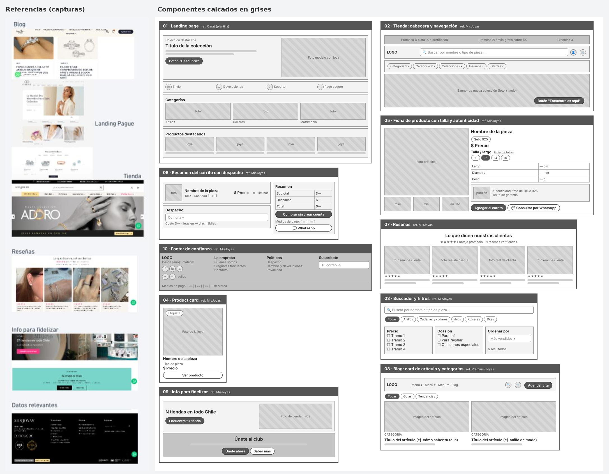

# Componentes — Joyas Kofran

> Guía: [Componentes](../evaluacion/guias/fase-2-specs/03-calco-de-componentes.md)

**Tablero en Whimsical:** [Joyas Kofran - Componentes](https://whimsical.com/franco-reyes2/34Fd4TELs1XmV6FNetkYD8)

Se calcaron 10 componentes que cubren la landing, el blog y la tienda. El tablero de Whimsical reúne las capturas de referencia; los calcos están en grises y sin fotos, con solo la estructura (qué elementos tiene cada componente, en qué orden y cómo se distribuyen). Buscador y filtros, product card, ficha y carrito se calcaron desde MisJoyas sin captura en el tablero. Los calcos sueltos están en [`img/componentes/`](img/componentes/) y su fuente en [`img/componentes-fuente.html`](img/componentes-fuente.html).

Cada componente pasó al design system con un nombre de token (`DESIGN.md`) y se usa en las pantallas de `09-spec-diseno.md`.

| Componente | Referencia | Qué contiene | Qué necesidad resuelve |
|---|---|---|---|
| Landing page | Carat (plantilla) | Banner principal con la colección destacada y botón "Discover now", franja de beneficios (envío, devoluciones, soporte, pago seguro), categorías visuales (anillos, collares, joyas de matrimonio) y productos destacados | Presenta la marca de forma atractiva y lleva a Camila hacia una acción concreta (ver la colección o comprar). Transmite confianza desde el primer vistazo |
| Tienda (cabecera y navegación) | MisJoyas | Barra superior con promesas (plata 925 certificada, envío gratis sobre $99.990), buscador, menú por categorías (Plata 925, Colecciones, Insumos, Ofertas) y banner de nueva colección con botón "Encuéntralas aquí" | Permite encontrar y comprar rápido, con una navegación clara. Reduce las dudas con garantías visibles y destaca ofertas y novedades |
| Buscador y filtros | MisJoyas | Buscador por nombre o tipo de pieza, menú de categorías (anillos, cadenas y collares, aros, pulseras, dijes), filtros por precio y por ocasión (para mí, para regalar, ocasiones especiales) y orden de resultados | Encuentra rápido una pieza dentro de su presupuesto de $25.000 a $60.000 y puede filtrar por regalo sin revisar todo el catálogo |
| Product card | MisJoyas | Imagen de la joya, etiqueta ("Plata 925", "Nuevo"), nombre, tipo de pieza, precio y botón "Ver producto" | Ve precio, tipo de pieza y respaldo de la plata de un vistazo, sin tener que preguntar por WhatsApp |
| Ficha de producto con talla y autenticidad | MisJoyas | Galería de fotos (también en uso real), precio, selector de talla o largo, enlace a la guía de tallas, medidas (largo de cadena, diámetro de anillo, peso), sello 925 con foto del punzón, garantía y botón "Consultar por WhatsApp" con el mensaje de la pieza ya escrito | Compra sin miedo a equivocarse de talla ni a que la plata no sea 925, y resuelve dudas por WhatsApp sin explicar de nuevo qué pieza estaba viendo |
| Resumen del carrito con despacho | MisJoyas | Pieza con talla y cantidad, botón eliminar, costo y plazo de despacho según comuna, subtotal, total, botón de compra sin crear cuenta, medios de pago (Webpay y transferencia) y acceso a WhatsApp | Sabe cuánto va a pagar y cuándo llega antes de pagar, y no se lleva sorpresas con el despacho si el regalo es para una fecha puntual |
| Reseñas | MisJoyas | Sección "Lo que dicen nuestras clientas": puntaje 4,9 de 5, más de 1.600 reseñas verificadas, fotos reales de clientas y comentarios | Genera confianza y prueba social. Responde al miedo a comprar joyas online sin verlas ("¿será como en la foto?") |
| Blog (card de artículo y categorías) | Premium Joyas | Artículos en tarjetas con categoría ("Guías", "Tendencias"), por ejemplo cómo saber la talla de un anillo y el anillo de compromiso de moda. Menú de navegación, buscador, carrito y botón "Agendar cita" | Atrae visitas desde Google con contenido útil. Educa a Camila antes de comprar y posiciona la marca como experta, llevándola a las piezas mencionadas |
| Info para fidelizar | MisJoyas | Sección "37 tiendas en todo Chile" con botón para encontrar tienda y bloque "Club MisJoyas" para acumular puntos, con botones "Únete ahora" y "Saber más" | Mantiene al cliente en la marca después de la primera compra. Da respaldo físico y una razón para volver (puntos y beneficios) |
| Footer de confianza | MisJoyas | "Desde 1990", plata 925 y baño de oro. Enlaces a quiénes somos, preguntas frecuentes, contacto y políticas (despacho, cambios, privacidad). Redes sociales, sellos, medios de pago (Webpay, Mercado Pago, transferencia) y suscripción por email | Resuelve sus dudas de compra, confirma que la tienda es seria y le muestra cómo pagar y reclamar antes de decidir |

## De componente calcado a design system

| Componente calcado | Token en `DESIGN.md` | Pantallas donde se usa | Qué se adaptó para Camila |
|---|---|---|---|
| Landing page (Carat) | `trust-bar`, `benefit-item`, `card-category` | Landing | El botón en inglés "Discover now" pasó a "Ver colección", y la franja de beneficios ahora destaca plata 925, garantía, despacho y WhatsApp |
| Tienda: cabecera y navegación (MisJoyas) | `navbar`, `trust-bar` | Todas | Menú reducido a Tienda, Blog y Contacto para no saturar el celular |
| Buscador y filtros (MisJoyas) | `search-bar`, `chip-filter` | Tienda | Filtros por precio en tramos de su presupuesto ($20.000 a $60.000) y por ocasión ("Para regalar") |
| Product card (MisJoyas) | `card-product`, `tag-925`, `price` | Landing, Tienda, Ficha | Etiqueta "Plata 925" en cada tarjeta y precio siempre visible en pesos chilenos |
| Ficha con talla y autenticidad (MisJoyas) | `size-selector`, `button-primary`, `button-whatsapp` | Ficha de producto | Medidas en mm, cm y g, sello del punzón y despacho por comuna antes de "Agregar al carrito" |
| Resumen del carrito con despacho (MisJoyas) | `cart-summary`, `message-success` | Carrito | Sin cuenta obligatoria y solo Webpay o transferencia |
| Reseñas (MisJoyas) | `card-review` | Landing | Nombre y comuna de la clienta, sin cifras de reseñas inventadas |
| Blog: card de artículo y categorías (Premium Joyas) | `card-article`, `chip-filter` | Landing, Blog, Artículo | Categorías según sus necesidades: cuidado de la plata, cómo elegir bien y regalos |
| Info para fidelizar (MisJoyas) | `lead-form` | Landing, Blog | Cambiado a "Recibe novedades y recordatorios para regalar": Joyas Kofran no tiene tiendas físicas ni club de puntos |
| Footer de confianza (MisJoyas) | `footer` | Todas | Se quitaron "Desde 1990" y el baño de oro porque no corresponden a Joyas Kofran |

