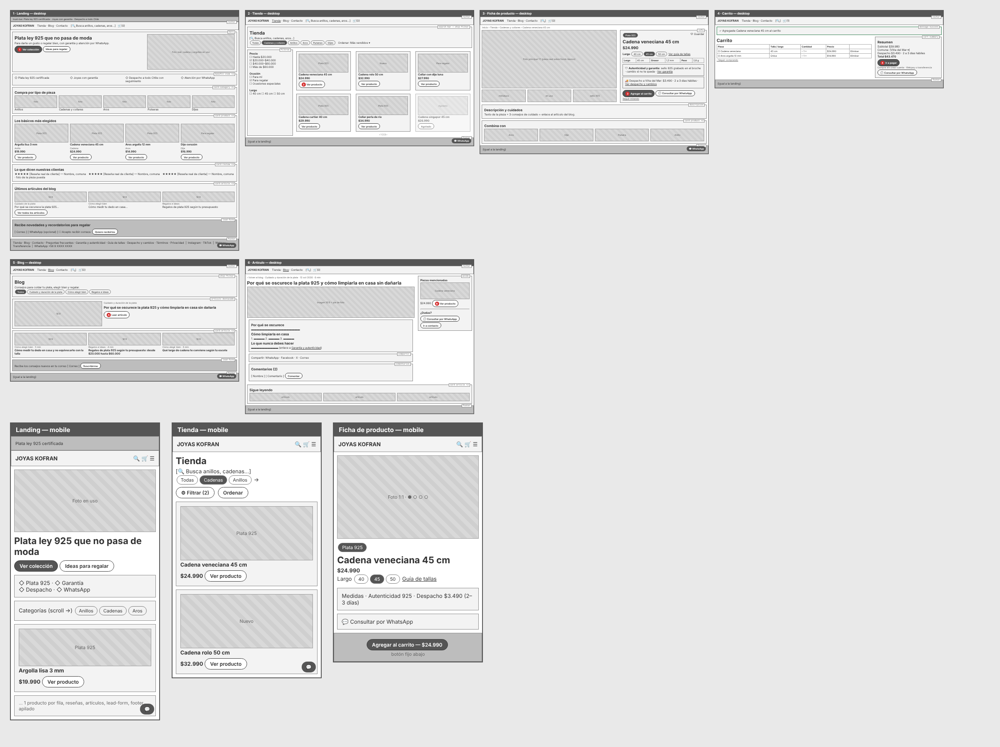

# Spec de diseño — Joyas Kofran

> Guía: [Spec de diseño](../evaluacion/guias/fase-2-specs/06-spec-de-diseno.md)

La spec de diseño tiene dos partes:

1. **[`DESIGN.md`](../DESIGN.md)** (en la raíz): el design system de Joyas Kofran, en el formato que Stitch importa.
2. **Este documento:** las pantallas, escritas como prompts listos para pegar en Stitch.

## Wireframes

> Guía de wireframes: [Wireframes](../evaluacion/guias/fase-2-specs/04-wireframes.md)

Wireframes de baja fidelidad de las 6 pantallas en desktop, más la landing, la tienda y la ficha de producto en mobile (fuente editable: [wireframes-fuente.html](img/wireframes-fuente.html)). Se construyeron con los componentes calcados en [07-componentes.md](07-componentes.md) y siguen los user flows de [05-arquitectura.md](05-arquitectura.md).

**Tablero en Whimsical:** [Joyas Kofran - Wireframes](https://whimsical.com/franco-reyes2/joyas-kofran-wireframes-LcZKw6fAUcidoP7nKimJUd) — las 6 pantallas desktop y 3 mobile, numeradas, con flechas para el flujo de compra (1→2→3→4) y el de contenido (5→6→3).



Los círculos rojos marcan los pasos de los flujos:

- **Flujo de compra (1 → 4):** Landing [Ver colección] → Tienda [Ver producto] → Ficha [Agregar al carrito] → Carrito [Ir a pagar]. Si Camila llega desde Instagram, entra directo en el paso 3.
- **Flujo de contenido (A → B):** Blog [Leer artículo] → Artículo [Ver producto] → Ficha. Desde el artículo también puede ir a Contacto o a WhatsApp.

| Pantalla | Desktop | Mobile |
|---|---|---|
| Landing | [wireframe-landing.png](img/wireframe-landing.png) | [wireframe-m-landing.png](img/wireframe-m-landing.png) |
| Tienda | [wireframe-tienda.png](img/wireframe-tienda.png) | [wireframe-m-tienda.png](img/wireframe-m-tienda.png) |
| Ficha de producto | [wireframe-producto.png](img/wireframe-producto.png) | [wireframe-m-producto.png](img/wireframe-m-producto.png) |
| Carrito | [wireframe-carrito.png](img/wireframe-carrito.png) | — |
| Blog | [wireframe-blog.png](img/wireframe-blog.png) | — |
| Artículo | [wireframe-articulo.png](img/wireframe-articulo.png) | — |

### Dónde aparece cada funcionalidad

| Funcionalidad (03-funcionalidades.md) | Prioridad | Pantalla y componente |
|---|---|---|
| Captación de leads | Imprescindible | Landing y Blog: `lead-form` |
| Buscar productos | Imprescindible | Navbar y Tienda: `search-bar` |
| Filtrar por tipo, precio, ocasión y medida | Imprescindible | Tienda: `chip-filter` y columna de filtros |
| Ver detalle, elegir talla y agregar al carrito | Imprescindible | Ficha: `size-selector` y `button-primary` |
| Conocer la medida correcta | Imprescindible | Ficha: tabla de medidas y enlace "Ver guía de tallas" |
| Verificar plata 925 y garantía | Imprescindible | Ficha: bloque de autenticidad; todas: `trust-bar` y `tag-925` |
| Costo y plazo de despacho antes de pagar | Imprescindible | Ficha: bloque de despacho; Carrito: `cart-summary` con comuna |
| Consultar por WhatsApp sobre una pieza | Imprescindible | Ficha, Carrito y Artículo: `button-whatsapp`; todas: botón flotante |
| Comprar sin cuenta con Webpay o transferencia | Imprescindible | Carrito: `cart-summary` |
| Navegar artículos por categoría | Deseable | Blog: `chip-filter` |
| Compartir un artículo | Deseable | Artículo: barra de compartir |
| Guardar favoritos | Deseable | Ficha: botón "♡ Guardar" (prototipo visual) |
| Sugerencias de regalo por ocasión y presupuesto | Deseable | Landing: botón "Ideas para regalar"; Tienda: filtro "Para regalar" |
| Pasar del artículo a las piezas mencionadas | Deseable | Artículo: aside "Piezas mencionadas" |
| Comentar un artículo | Futuro | Artículo: formulario de comentarios (solo visual) |

## Pantallas

Cada prompt nombra los componentes tal como están en `DESIGN.md`. Los nombres de productos, precios y costos de despacho son valores de referencia para el prototipo; se reemplazan por los del catálogo real en la etapa de código.

**Reglas para todas las pantallas (pegar al inicio de cada prompt si Stitch se desvía):**

```text
Joyas Kofran vende solo joyas de plata ley 925 en Chile. Precios en pesos
chilenos con formato $29.990, nunca USD. Tono cercano y claro, en español de
Chile, con tuteo. Usa textos reales, nunca marcadores entre corchetes como
[Título] o [$XX.XXX]. No menciones oro, platino, diamantes, certificados GIA,
"atelier", "alta joyería" ni "inversión". No inventes años de trayectoria,
cifras de clientas, fundadores, plazos de garantía ni políticas de cambio.
Navbar azul con exactamente: logo "Joyas Kofran", Tienda, Blog, Contacto,
buscador y carrito. Footer azul idéntico en todas las pantallas, con solo
Webpay y transferencia. Un único WhatsApp: +56 9 XXXX XXXX.
```

### 1. Landing

```text
Pantalla: Landing de Joyas Kofran, versión desktop (1280px). Usa el design system del proyecto.
Objetivo: que Camila, que llega desde Instagram o Google, confíe en la marca en
pocos segundos y entre a la colección o deje su correo para recibir novedades.
Componentes, de arriba hacia abajo:
1. trust-bar: "Plata ley 925 certificada · Joyas con garantía · Despacho a todo Chile".
2. navbar: logo "Joyas Kofran", Tienda, Blog, Contacto, search-bar "Busca anillos,
   cadenas, aros…" e ícono de carrito.
3. Hero en dos columnas: a la izquierda h1 "Plata ley 925 que no pasa de moda",
   texto "Para darte un gusto o regalar bien, con garantía y atención por WhatsApp",
   button-primary "Ver colección" y button-secondary "Ideas para regalar". A la
   derecha, foto de una cadena fina y argollas de plata puestas.
4. Fila de 4 benefit-item: "Plata ley 925 certificada", "Joyas con garantía",
   "Despacho a todo Chile con seguimiento", "Atención por WhatsApp".
5. h2 "Compra por tipo de pieza" y 5 card-category: Anillos, Cadenas y collares,
   Aros, Pulseras, Dijes.
6. h2 "Los básicos más elegidos" y 4 card-product con tag-925: Argolla lisa 3 mm
   $19.990, Cadena veneciana 45 cm $24.990, Aros argolla 12 mm $14.990, Dije
   corazón $16.990 (etiqueta "Para regalar"). Botón "Ver producto" en cada una.
7. h2 "Lo que dicen nuestras clientas" y 3 card-review con 5 estrellas, comentario,
   nombre y comuna.
8. h2 "Últimos artículos del blog" y 3 card-article: "Por qué se oscurece la plata
   925 y cómo limpiarla en casa sin dañarla" (Cuidado de la plata), "Cómo medir tu
   dedo en casa y no equivocarte con la talla" (Cómo elegir bien), "Regalos de plata
   925 según tu presupuesto" (Regalos e ideas). button-secondary "Ver todos los artículos".
9. lead-form: "Recibe novedades y recordatorios para regalar", input-field Correo,
   input-field WhatsApp (opcional), casilla de consentimiento, botón "Quiero recibirlos".
10. footer y button-whatsapp flotante abajo a la derecha.
```

### 2. Tienda

```text
Pantalla: Tienda de Joyas Kofran, versión desktop (1280px). Usa el design system del proyecto.
Objetivo: que Camila encuentre rápido una pieza dentro de su presupuesto
($25.000 a $60.000) o un regalo, sin revisar todo el catálogo.
Componentes, de arriba hacia abajo:
1. trust-bar y navbar (Tienda marcada como página actual).
2. h1 "Tienda" y search-bar "Busca anillos, cadenas, aros…".
3. Fila de chip-filter: Todas, Anillos, Cadenas y collares (activo), Aros,
   Pulseras, Dijes. A la derecha, selector "Ordenar: Más vendidos".
4. A la izquierda, columna de filtros de 240px: Precio (Hasta $20.000,
   $20.000–$40.000 marcado, $40.000–$60.000, Más de $60.000), Ocasión (Para mí,
   Para regalar marcado, Ocasiones especiales) y Largo (40 cm, 45 cm, 50 cm).
5. A la derecha, grilla de 3 columnas con 6 card-product: Cadena veneciana 45 cm
   $24.990, Cadena rolo 50 cm $32.990 (etiqueta "Nuevo"), Collar con dije luna
   $27.990 (etiqueta "Para regalar"), Cadena cartier 40 cm $29.990, Collar perla de
   río $34.990 y Cadena singapur 45 cm $26.990 en estado card-product-disabled
   ("Agotado"). Cada tarjeta con foto real sobre fondo blanco, nombre, precio y
   button-secondary "Ver producto".
6. Paginación "1 2 3".
7. footer y button-whatsapp flotante.
```

### 3. Ficha de producto

```text
Pantalla: Ficha de producto de Joyas Kofran, versión desktop (1280px). Usa el design system del proyecto.
Objetivo: que Camila compre sin miedo a equivocarse de talla ni a que la pieza
no sea plata 925, y sepa cuánto cuesta y demora el despacho antes de decidir.
Componentes, de arriba hacia abajo:
1. trust-bar y navbar.
2. Migas de pan: Inicio › Tienda › Cadenas y collares › Cadena veneciana 45 cm.
3. Dos columnas. Izquierda (60 %): foto principal cuadrada de la cadena sobre
   fondo blanco y 3 miniaturas (detalle, cadena puesta, sello 925 del broche).
   Derecha (40 %):
   - tag-925 "Plata 925" y h1 "Cadena veneciana 45 cm".
   - Precio $24.990 (componente price).
   - "Largo" con size-selector: 40 cm, 45 cm (seleccionado), 50 cm, y enlace
     "Ver guía de tallas".
   - Tabla de medidas: Largo 45 cm · Grosor 1,2 mm · Peso 2,8 g.
   - Bloque "Autenticidad y garantía": sello 925 grabado en el broche, cambio si
     no te queda, enlace "Ver garantía".
   - Bloque de despacho: "Despacho a Viña del Mar: $3.490 · 2 a 3 días hábiles"
     y enlace "Ver despacho y cambios".
   - button-primary "Agregar al carrito", button-whatsapp "Consultar por WhatsApp"
     y enlace "Seguir mirando".
4. h2 "Descripción y cuidados": descripción de la pieza y 3 consejos para que no
   se oscurezca, con enlace al artículo del blog sobre el tema.
5. h2 "Combina con" y 4 card-product: Aros argolla 12 mm $14.990, Dije corazón
   $16.990, Pulsera eslabón $29.990, Argolla lisa 3 mm $19.990.
6. footer y button-whatsapp flotante.
```

### 4. Carrito

```text
Pantalla: Carrito de Joyas Kofran, versión desktop (1280px). Usa el design system del proyecto.
Objetivo: que Camila vea la pieza y la talla que eligió y sepa el total con
despacho antes de pagar, sin crear cuenta.
Componentes, de arriba hacia abajo:
1. navbar con el carrito mostrando 2 piezas.
2. message-success: "Agregaste Cadena veneciana 45 cm al carrito".
3. Dos columnas. Izquierda: h1 "Carrito" y tabla con columnas Pieza, Talla o largo,
   Cantidad, Precio y Eliminar. Filas: Cadena veneciana · 45 cm · 1 · $24.990;
   Aros argolla 12 mm · Única · 1 · $14.990. Debajo, enlace "Seguir comprando".
   Derecha: cart-summary con Subtotal $39.980, selector "Comuna: Viña del Mar",
   "Despacho $3.490 · 2 a 3 días hábiles", Total $43.470, button-primary
   "Ir a pagar", texto "Compra sin crear cuenta · Webpay o transferencia" y
   button-whatsapp.
4. footer.
Sin empaque de lujo, grabado, dedicatorias caligráficas, códigos de invitación
ni cuentas regresivas.
```

### 5. Blog

```text
Pantalla: Blog de Joyas Kofran, versión desktop (1280px). Usa el design system del proyecto.
Objetivo: que Camila encuentre consejos para cuidar su plata, elegir la talla y
regalar bien, y desde ahí llegue a los productos.
Componentes, de arriba hacia abajo:
1. navbar (Blog marcado como página actual).
2. h1 "Blog" y texto "Consejos para cuidar tu plata, elegir bien y regalar".
3. chip-filter: Todos (activo), Cuidado y duración de la plata, Cómo elegir bien,
   Regalos e ideas.
4. Artículo destacado en dos columnas: imagen 16:9 a la izquierda; a la derecha,
   categoría "Cuidado y duración de la plata", h2 "Por qué se oscurece la plata 925
   y cómo limpiarla en casa sin dañarla" y button-primary "Leer artículo".
5. Grilla de 3 card-article: "Cómo medir tu dedo en casa y no equivocarte con la
   talla" (Cómo elegir bien, 5 min), "Regalos de plata 925 según tu presupuesto:
   desde $20.000 hasta $60.000" (Regalos e ideas, 4 min), "Qué largo de cadena te
   conviene según tu escote" (Cómo elegir bien, 3 min).
6. lead-form corto: "Recibe los consejos nuevos en tu correo", input-field Correo y
   botón "Suscribirme".
7. footer y button-whatsapp flotante.
```

### 6. Artículo

```text
Pantalla: Artículo del blog de Joyas Kofran, versión desktop (1280px). Usa el design system del proyecto.
Objetivo: que Camila resuelva su duda sobre la plata que se oscurece, confíe en la
calidad de las piezas y pase a una ficha de producto, a Contacto o a WhatsApp.
Componentes, de arriba hacia abajo:
1. navbar (Blog marcado como página actual).
2. Enlace "Volver al blog", categoría "Cuidado y duración de la plata", fecha
   12 de octubre de 2026 y "6 min de lectura".
3. Un solo h1: "Por qué se oscurece la plata 925 y cómo limpiarla en casa sin dañarla".
4. Imagen 16:9 de una cadena de plata con pie de foto.
5. Dos columnas. Izquierda: cuerpo del artículo con h2 "Por qué se oscurece",
   h2 "Cómo limpiarla en casa" (3 pasos numerados) y h2 "Lo que nunca debes hacer",
   con un enlace a "Garantía y autenticidad". Debajo, barra para compartir en
   WhatsApp, Facebook, X y correo, y formulario de comentarios (Nombre, Comentario,
   botón "Comentar"). Derecha: aside "Piezas mencionadas" con un card-product de
   Cadena veneciana 45 cm $24.990 y botón "Ver producto"; bloque "¿Dudas?" con
   button-whatsapp y button-secondary "Ir a contacto".
6. h2 "Sigue leyendo" con 3 card-article.
7. footer.
```

### Versión mobile (para cada pantalla)

```text
Genera la versión mobile (375px de ancho) de esta pantalla siguiendo la sección
Layout del design system:
- navbar con logo, ícono de búsqueda, carrito y menú hamburguesa (sin enlaces a
  la vista). trust-bar con un solo mensaje.
- Todo en 1 columna: card-product, card-article y card-category de a una por fila
  (las categorías pueden ir como chip-filter con scroll horizontal).
- Tienda: chip-filter con scroll horizontal y un button-secondary "Filtrar" que
  abre los filtros en un panel; no muestres la columna lateral.
- Ficha de producto: galería arriba con puntos, información debajo y
  button-primary "Agregar al carrito — $24.990" fijo en la parte inferior.
- Carrito: lista de piezas arriba y cart-summary debajo.
- Artículo: el aside "Piezas mencionadas" pasa al final del texto. Un solo h1.
- Párrafos de 16px, h1 de 32px, botones y enlaces de al menos 44×44px, sin
  scroll horizontal. button-whatsapp flotante sin tapar el botón fijo.
- Mismos textos, precios en pesos chilenos y mismo design system que la versión desktop.
- Header con el logo en todas las pantallas (nunca un título de pantalla), sin barra
  de navegación inferior y un solo h1. Footer azul igual al de desktop.
```
