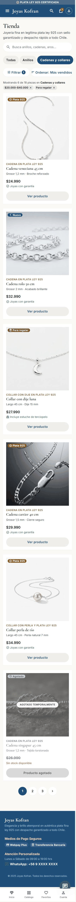
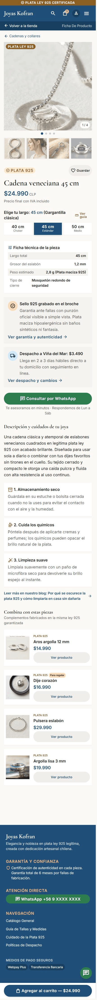
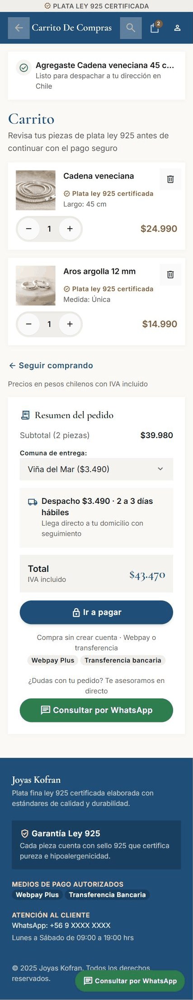
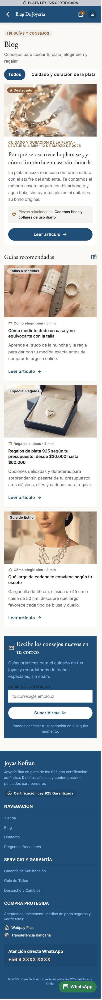
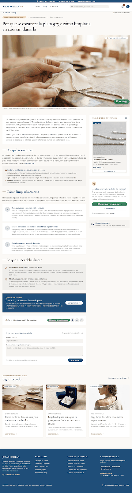
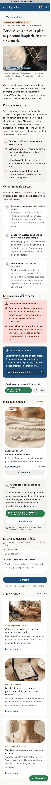

# QA — Joyas Kofran

> Guía: [QA y coherencia](../evaluacion/guias/fase-3-prototipo/02-qa-y-coherencia.md)

## Prototipo en Stitch

> Guía: [Prototipo en Stitch](../evaluacion/guias/fase-3-prototipo/01-prototipo-en-stitch.md)

**Proyecto:** https://stitch.withgoogle.com/projects/17675665430477937727

El prototipo se hizo en **dos rondas**. En la primera ronda (proyecto anterior, `16219822956842085906`) Stitch generó una joyería de lujo que no correspondía al brief. Con esos errores se reescribieron el `DESIGN.md` y los prompts de `09-spec-diseno.md`, se importó el `DESIGN.md` nuevo como design system del proyecto actual y se volvieron a generar las 6 pantallas desktop, una por prompt. Después se generó la versión mobile de cada una con el prompt mobile, seleccionando la pantalla desktop correspondiente. El código exportado de las 12 pantallas está en [`stitch/`](../stitch/README.md).

| Pantalla | Desktop | Mobile |
|---|---|---|
| Landing |  |  |
| Tienda |  |  |
| Ficha de producto |  |  |
| Carrito |  |  |
| Blog |  |  |
| Artículo |  |  |

## Revisión: spec vs. prototipo

### Ronda 1 → Ronda 2: errores del primer prototipo

| Pantalla | Qué dice la spec | Qué generó Stitch (ronda 1) | Resultado | Corrección |
|---|---|---|---|---|
| Todas | Joyas de plata ley 925 (brief) | Alta joyería con diamantes GIA, platino 950 y oro 18K | ❌ → ✅ | `DESIGN.md` con Don't "no mencionar oro, platino, diamantes ni GIA" y bloque de reglas al inicio de cada prompt. En la ronda 2 todas las pantallas hablan de plata ley 925 |
| Todas | Venta en Chile | Precios en USD ("$8,450 USD") | ❌ → ✅ | Regla "precios en pesos chilenos con formato $29.990". Ronda 2: $19.990, $24.990, total $43.470 |
| Landing, Tienda, Ficha | Confiabilidad, calidad con garantía y buena atención | Tono de lujo: "Haute Joaillerie", "Atelier privado", "Inversión" | ❌ → ✅ | Overview del `DESIGN.md` con tono cercano y Don't de lenguaje de alta joyería. Ronda 2: "Plata ley 925 que no pasa de moda", tuteo |
| Landing, Artículo | Datos del negocio salen del brief | "Atelier 1994", "30+ años", fundador "D. Alberto Kofran" | ❌ → ✅ | Don't "no inventar cifras ni historia del negocio". Ronda 2 sin años ni fundador |
| Navegación | Menú Tienda, Blog, Contacto y carrito | Colecciones, Anillos, Collares, Personalizados, Sobre Nosotros; sin Blog | ❌ → ✅ | Regla de navbar en `DESIGN.md` y en cada prompt. Ronda 2: Tienda · Blog · Contacto en las 6 pantallas |
| Landing | Sección de artículos del blog | No existía | ❌ → ✅ | Paso 8 del prompt de la landing. Ronda 2: "Últimos artículos del blog" con 3 tarjetas |
| Colores | Una sola paleta | Tres azules distintos entre documentos y código | ❌ → ✅ | Paleta única `#1F4E79` en `08`, `DESIGN.md` y `10` |
| Tipografía | Cormorant Garamond + Inter | Playfair Display + Plus Jakarta Sans | ❌ → ✅ | Tokens de tipografía del `DESIGN.md` corregidos. Ronda 2 con Cormorant Garamond en títulos e Inter en textos |
| Ficha de producto | Guía de tallas, garantía y WhatsApp visibles | Los tenía, con textos de lujo | ✅ → ✅ | Se mantuvo; ahora con sello 925, medidas y despacho |
| Carrito | Carrito simple | Grabado láser, dedicatoria caligráfica, código de invitación, cuenta regresiva | ❌ → ✅ | Prompt del carrito con "sin empaque de lujo, grabado ni cuentas regresivas". Ronda 2 sin esos extras |
| Contacto | Un solo WhatsApp | Números de España, EE. UU. y Santiago | ❌ → ❌ | Regla "un único WhatsApp +56 9 XXXX XXXX". Se cumple en 5 pantallas, pero el blog muestra otro número (ver ronda 2) |

### Ronda 2: revisión de cada pantalla contra su prompt y el `DESIGN.md`

| Pantalla | Qué dice la spec | Qué generó Stitch | Resultado | Corrección |
|---|---|---|---|---|
| Intermedia | Textos reales del negocio | En un primer intento del proyecto nuevo, todas las pantallas salieron con marcadores: "[Titular Principal de Propuesta de Valor]", "[$XX.XXX]", "[Nombre Clienta 1]" | ❌ → ✅ | Se agregó a las reglas: "usa textos reales, nunca marcadores entre corchetes". Ronda 2 sin marcadores |
| Landing | Hero con h1, "Ver colección" e "Ideas para regalar" | Correcto, en el orden pedido | ✅ | — |
| Landing | Foto real de una cadena y argollas puestas | La foto del hero trae encima la captura de otro sitio ("KOFRAN" con su propio menú) | ❌ | Regenerar solo la imagen del hero pidiendo "foto sin interfaz ni texto encima" |
| Landing | 4 `benefit-item`, 5 `card-category`, 4 `card-product` con precio, reseñas, artículos y `lead-form` | Todo presente, con los textos y precios del prompt | ✅ | — |
| Landing, Tienda, Ficha | Garantía con el plazo real | "Garantía de 6 meses" y "6 meses de cobertura" | ✅ | El plazo no estaba en el brief y se marcó como posible invento, pero el dueño confirmó que la garantía real es de 6 meses. Se dejó escrito en el `DESIGN.md` y en las reglas del prompt para que no aparezca otro plazo |
| Tienda | Chips, filtros de precio, ocasión y largo, 6 `card-product`, una agotada y paginación | Todo presente; "Cadenas y collares", "$20.000–$40.000" y "Para regalar" marcados | ✅ | — |
| Tienda | Foto real de cada pieza (`card-product`) | Recuadros lilas con un ícono de imagen | ❌ | Stitch no generó fotos en esta pantalla. Pedirle "foto real de cada pieza sobre fondo blanco"; en la etapa de código se usan las fotos del catálogo |
| Ficha de producto | Medidas, sello 925, despacho y "Agregar al carrito" sin hacer scroll | Todo presente: largo 45 cm activo, tabla de medidas, sello en el broche, despacho $3.490 a Viña del Mar | ✅ | — |
| Ficha, Carrito, Blog | `navbar` con fondo azul `primary` | Navbar blanco (solo landing y tienda en azul) | ❌ | Se agregó al `DESIGN.md`: "el navbar siempre tiene fondo azul en todas las pantallas" |
| Carrito | Tabla, `cart-summary`, comuna, total, "Ir a pagar", "Compra sin crear cuenta" | Todo presente; total $43.470 | ✅ | — |
| Carrito | Sin servicios extra | Bloque nuevo: "Cambio sin costo 30 días" y "Empaque protegido" | ❌ | Políticas no definidas en el brief. Cubierto por el nuevo Don't sobre políticas inventadas |
| Todas | Mismo `footer` en todas las pantallas | El footer cambia: enlaces distintos en carrito, footer claro en el blog y "Redcompra" como medio de pago extra | ❌ | Se agregó al `DESIGN.md`: footer idéntico en todas, fondo azul y solo Webpay y transferencia |
| Blog | Un único WhatsApp +56 9 XXXX XXXX | "+56 9 8765 4321" y botón "¿Dudas? Escríbenos" | ❌ | Mismo ajuste del footer; el botón debe decir "Consultar por WhatsApp" |
| Blog | Chips de categoría, artículo destacado, 3 `card-article` y `lead-form` | Todo presente con los títulos del prompt | ✅ | — |
| Artículo | Un solo h1, aside "Piezas mencionadas", compartir, comentarios y "Sigue leyendo" | Todo presente: un solo h1, aside "Recomendado en este artículo" con la Cadena veneciana $24.990, bloque "¿Dudas?" con WhatsApp y contacto, 3 pasos de limpieza | ✅ | — |
| Artículo | Garantía con el plazo real y solo Webpay y transferencia | Bloque "Garantía y autenticidad" con "6 meses de respaldo" (correcto) y "Redcompra" en el footer | ❌ | La garantía está bien; el error es Redcompra. Don't de medios de pago; regenerar el footer |

### Ronda 2: versión mobile

| Pantalla | Qué dice la spec (prompt mobile y `## Layout`) | Qué generó Stitch | Resultado | Corrección |
|---|---|---|---|---|
| Todas | Navbar azul con logo, búsqueda, carrito y menú hamburguesa | Landing, tienda y ficha cumplen. Carrito, blog y artículo reemplazan el logo por una flecha y un título ("Carrito De Compras", "Blog De Joyeria") | ❌ | Se agregó a `DESIGN.md`: "en mobile el header siempre muestra el logo; nunca se reemplaza por un título de pantalla" |
| Landing, Tienda | Sin elementos de navegación extra | Barra inferior de íconos (Inicio, Catálogo, Garantía, Bolsa, Contacto / Inicio, Catálogo, Favoritos, Cuenta) | ❌ | Mismo error que la ronda 1. Se agregó el Don't "en mobile no hay barra de navegación inferior" |
| Landing | 1 columna: beneficios 2×2, categorías con scroll, 1 producto por fila, reseñas, artículos, `lead-form` | Todo presente y en una columna | ✅ | — |
| Landing | Foto del hero sin interfaz encima | La foto trae una tarjeta "Colección Otoño 2024" con íconos de otra app | ❌ | Se repite en desktop; la regla de fotos ya está en el `DESIGN.md`. Pedir solo la imagen al regenerar |
| Tienda | Chips con scroll, botón "Filtrar (2)" y "Ordenar", sin columna lateral, 1 producto por fila | Todo presente, con fotos reales de cada pieza y la Cadena singapur agotada | ✅ | En mobile sí aparecieron las fotos que faltaban en desktop |
| Ficha de producto | Galería con puntos, selector de largo, medidas, sello 925, despacho y "Agregar al carrito — $24.990" fijo abajo | Todo presente; el botón queda fijo y el WhatsApp flotante no lo tapa | ✅ | — |
| Ficha, Artículo | Garantía con el plazo real | "Garantía total de 6 meses" en el footer de la ficha y "respaldo de 6 meses" en el artículo | ✅ | Coincide con la garantía real de 6 meses confirmada por el dueño |
| Carrito | Lista apilada, `cart-summary` debajo, sin políticas inventadas | Lista apilada con cantidades, resumen con comuna, total $43.470, "Ir a pagar" y WhatsApp; sin "cambio en 30 días" ni "empaque" | ✅ | El prompt mobile con "sin bloques de políticas inventadas" corrigió el error de desktop |
| Blog | Chips, destacado, `card-article` en 1 columna, `lead-form` y footer con un solo WhatsApp | Todo presente; el footer ya usa +56 9 XXXX XXXX y solo Webpay y transferencia | ✅ | Corrige el número inventado del blog desktop |
| Artículo | Un solo h1 | Dos h1: "Blog De Joyeria" en el header y el título del artículo | ❌ | Mismo error de la ronda 1. Se agregó al `DESIGN.md`: "un solo h1 por pantalla; el header nunca usa h1" |
| Artículo | Footer igual al de las otras pantallas | No tiene footer | ❌ | Regenerar pidiendo el footer; queda anotado para la etapa de código |
| Todas | Párrafos de 16px, botones de 44px, sin scroll horizontal | Se cumple en las 6 pantallas (solo los chips tienen scroll horizontal) | ✅ | — |

## Mejoras a mis specs

1. **`DESIGN.md` reescrito** a partir de la ronda 1: paleta única `#1F4E79`, tipografía Cormorant Garamond + Inter, 42 componentes con estados y Do's and Don'ts contra oro, USD, tono de lujo y cifras inventadas.
2. **Bloque de reglas al inicio de cada prompt** en `09-spec-diseno.md` (plata 925, CLP, tono, navbar fijo, un WhatsApp), porque en la ronda 1 Stitch ignoraba el brief.
3. **Regla contra marcadores entre corchetes**, agregada después de que el primer intento de la ronda 2 saliera con "[Título]" y "[$XX.XXX]".
4. **Nuevos Don'ts en `DESIGN.md`** después de la ronda 2 desktop: navbar siempre azul, footer idéntico en todas las pantallas, solo Webpay y transferencia, no inventar políticas de cambio, y fotos sin interfaz encima. Después se confirmó que la garantía real es de 6 meses, así que la regla quedó como "garantía de 6 meses, ningún otro plazo".
5. **Prompt mobile por pantalla:** en vez de un prompt genérico, cada pantalla recibió su prompt mobile con los componentes y textos exactos. Así se corrigieron en mobile el carrito con políticas inventadas, el número de WhatsApp del blog y las fotos de la tienda.
6. **Reglas mobile en `DESIGN.md`** después de revisar la versión mobile: header con logo en todas las pantallas, sin barra de navegación inferior y un solo h1 por pantalla.

## User flows

| Flujo | Recorrido en el prototipo | ¿Se completa? |
|---|---|---|
| Compra (desde Instagram) | Ficha de producto → [elige largo 45 cm] → [Agregar al carrito] → Carrito con la pieza y el largo | ✅ |
| Compra (desde la landing) | Landing → [Ver colección] → Tienda → [Ver producto] → Ficha → [Agregar al carrito] → Carrito | ✅ |
| Compra: dudas | Ficha → [Ver guía de tallas] / [Ver garantía y autenticidad] / [Ver despacho y cambios] | ⚠️ Los enlaces están en la ficha; las páginas de destino no son parte de las 6 pantallas del prototipo |
| Compra: WhatsApp | Ficha → [Consultar por WhatsApp] | ✅ |
| Contenido | Google → Artículo → [Ver producto] en "Piezas mencionadas" → Ficha de producto | ✅ |
| Contenido: desde el blog | Blog → [Leer artículo] → Artículo | ✅ |
| Contenido: contacto | Artículo → [Consultar por WhatsApp] o [Ir a contacto] | ✅ |
| Contenido: lead | Landing o Blog → `lead-form` con correo | ✅ |

Las pantallas todavía no están enlazadas en el modo prototipo de Stitch. El recorrido se muestra con la secuencia de capturas.

## Coherencia

El brief define a Joyas Kofran como una joyería de plata ley 925 cuyo diferencial es la confiabilidad, y la ronda 2 del prototipo lo refleja: "plata ley 925" aparece en la barra de confianza, en cada tarjeta y en la ficha, y el tono pasó del lujo exclusivo de la ronda 1 a uno cercano y en pesos chilenos. Las frustraciones de Camila tienen respuesta concreta: para el miedo a que la joya se oscurezca, el sello 925 en el broche, los consejos de cuidado en la ficha y el artículo del blog; para no equivocarse de talla, el selector de largo y la tabla de medidas; para las sorpresas en el precio, el costo y plazo de despacho por comuna en la ficha y en el carrito; y para la desconfianza, el WhatsApp visible en todas las pantallas y la compra sin crear cuenta. Lo que más cambió desde la Fase 1 fue la spec, no el sitio: el primer prototipo demostró que una spec vaga deja que la IA invente la marca, y por eso el `DESIGN.md` terminó lleno de reglas verificables y prohibiciones. La versión mobile, la más importante para Camila porque compra desde el celular y de noche, mantiene todo lo esencial en una columna y deja fijo el botón "Agregar al carrito". Sus errores (barra inferior y dos h1 en el artículo) quedaron como reglas nuevas en el `DESIGN.md` para la etapa de código.
