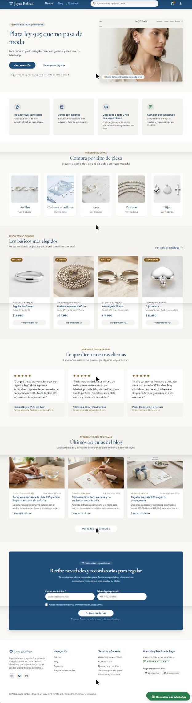
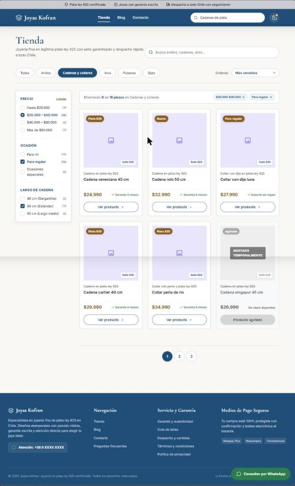
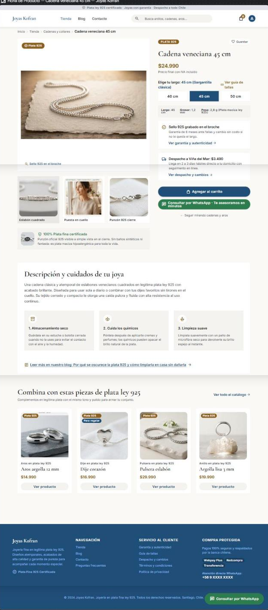
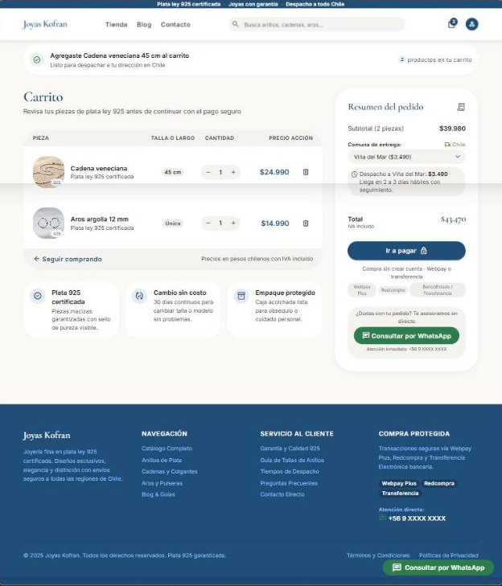
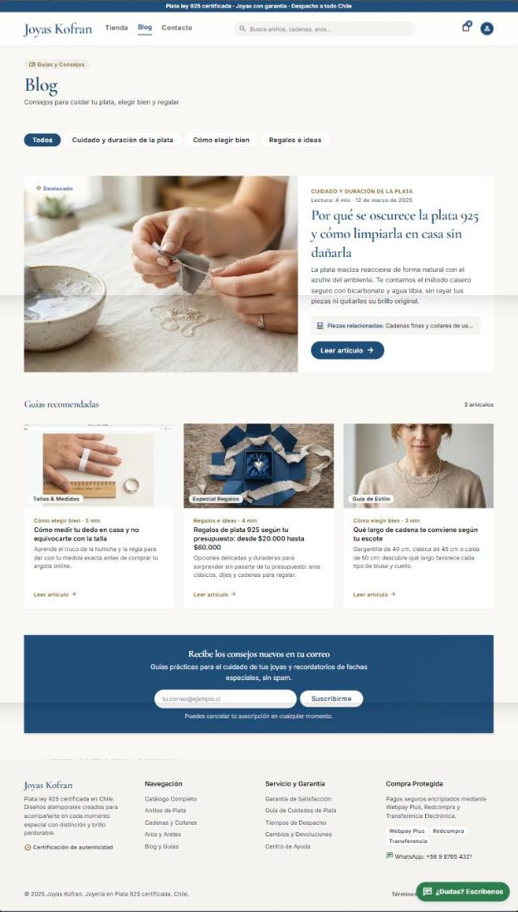

# QA — Joyas Kofran

> Guía: [QA y coherencia](../evaluacion/guias/fase-3-prototipo/02-qa-y-coherencia.md)

## Prototipo en Stitch

> Guía: [Prototipo en Stitch](../evaluacion/guias/fase-3-prototipo/01-prototipo-en-stitch.md)

**Proyecto:** https://stitch.withgoogle.com/projects/17675665430477937727

El prototipo se hizo en **dos rondas**. En la primera ronda (proyecto anterior, `16219822956842085906`) Stitch generó una joyería de lujo que no correspondía al brief. Con esos errores se reescribieron el `DESIGN.md` y los prompts de `09-spec-diseno.md`, se importó el `DESIGN.md` nuevo como design system del proyecto actual y se volvieron a generar las 6 pantallas desktop, una por prompt.

| Pantalla | Desktop | Mobile |
|---|---|---|
| Landing |  | Pendiente |
| Tienda |  | Pendiente |
| Ficha de producto |  | Pendiente |
| Carrito |  | Pendiente |
| Blog |  | Pendiente |
| Artículo | Generada en Stitch; captura pendiente | Pendiente |

> **Pendiente:** generar las 6 versiones mobile con el prompt mobile de `09-spec-diseno.md` y tomar la captura del artículo. Se guardan en `docs/img/` como `prototipo-<pantalla>-mobile.png` y `prototipo-articulo-desktop.png`.

## Revisión: spec vs. prototipo

### Ronda 1 → Ronda 2: errores del primer prototipo

| Pantalla | Qué dice la spec | Qué generó Stitch (ronda 1) | Resultado | Corrección |
|---|---|---|---|---|
| Todas | Joyas de plata ley 925 (brief) | Alta joyería con diamantes GIA, platino 950 y oro 18K | ❌ → ✅ | `DESIGN.md` con Don't "no mencionar oro, platino, diamantes ni GIA" y bloque de reglas al inicio de cada prompt. En la ronda 2 todas las pantallas hablan de plata ley 925 |
| Todas | Venta en Chile | Precios en USD ("$8,450 USD") | ❌ → ✅ | Regla "precios en pesos chilenos con formato $29.990". Ronda 2: $19.990, $24.990, total $43.470 |
| Landing, Tienda, Ficha | Confiabilidad, calidad con garantía y buena atención | Tono de lujo: "Haute Joaillerie", "Atelier privado", "Inversión" | ❌ → ✅ | Overview del `DESIGN.md` con tono cercano y Don't de lenguaje de alta joyería. Ronda 2: "Plata ley 925 que no pasa de moda", tuteo |
| Landing, Artículo | Datos del negocio salen del brief | "Atelier 1994", "30+ años", fundador "D. Alberto Kofran" | ❌ → ✅ | Don't "no inventar cifras ni historia del negocio". Ronda 2 sin años ni fundador |
| Navegación | Menú Tienda, Blog, Contacto y carrito | Colecciones, Anillos, Collares, Personalizados, Sobre Nosotros; sin Blog | ❌ → ✅ | Regla de navbar en `DESIGN.md` y en cada prompt. Ronda 2: Tienda · Blog · Contacto en las 6 pantallas |
| Landing | Sección de artículos del blog | No existía | ❌ → ✅ | Paso 8 del prompt de la landing. Ronda 2: "Últimos artículos del blog" con 3 tarjetas |
| Colores | Una sola paleta | Tres azules distintos entre documentos y código | ❌ → ✅ | Paleta única `#1F4E79` en `08`, `DESIGN.md` y `10` |
| Tipografía | Cormorant Garamond + Inter | Playfair Display + Plus Jakarta Sans | ❌ → ✅ | Tokens de tipografía del `DESIGN.md` corregidos. Ronda 2 con Cormorant Garamond en títulos e Inter en textos |
| Ficha de producto | Guía de tallas, garantía y WhatsApp visibles | Los tenía, con textos de lujo | ✅ → ✅ | Se mantuvo; ahora con sello 925, medidas y despacho |
| Carrito | Carrito simple | Grabado láser, dedicatoria caligráfica, código de invitación, cuenta regresiva | ❌ → ✅ | Prompt del carrito con "sin empaque de lujo, grabado ni cuentas regresivas". Ronda 2 sin esos extras |
| Contacto | Un solo WhatsApp | Números de España, EE. UU. y Santiago | ❌ → ❌ | Regla "un único WhatsApp +56 9 XXXX XXXX". Se cumple en 5 pantallas, pero el blog muestra otro número (ver ronda 2) |

### Ronda 2: revisión de cada pantalla contra su prompt y el `DESIGN.md`

| Pantalla | Qué dice la spec | Qué generó Stitch | Resultado | Corrección |
|---|---|---|---|---|
| Intermedia | Textos reales del negocio | En un primer intento del proyecto nuevo, todas las pantallas salieron con marcadores: "[Titular Principal de Propuesta de Valor]", "[$XX.XXX]", "[Nombre Clienta 1]" | ❌ → ✅ | Se agregó a las reglas: "usa textos reales, nunca marcadores entre corchetes". Ronda 2 sin marcadores |
| Landing | Hero con h1, "Ver colección" e "Ideas para regalar" | Correcto, en el orden pedido | ✅ | — |
| Landing | Foto real de una cadena y argollas puestas | La foto del hero trae encima la captura de otro sitio ("KOFRAN" con su propio menú) | ❌ | Regenerar solo la imagen del hero pidiendo "foto sin interfaz ni texto encima" |
| Landing | 4 `benefit-item`, 5 `card-category`, 4 `card-product` con precio, reseñas, artículos y `lead-form` | Todo presente, con los textos y precios del prompt | ✅ | — |
| Landing, Tienda, Ficha | Garantía sin plazo inventado | "Garantía de 6 meses" y "6 meses de cobertura" | ❌ | El plazo de garantía no está definido en el brief. Se agregó al `DESIGN.md` el Don't "no inventar plazos de garantía ni políticas de cambio"; falta regenerar o definir el plazo real |
| Tienda | Chips, filtros de precio, ocasión y largo, 6 `card-product`, una agotada y paginación | Todo presente; "Cadenas y collares", "$20.000–$40.000" y "Para regalar" marcados | ✅ | — |
| Tienda | Foto real de cada pieza (`card-product`) | Recuadros lilas con un ícono de imagen | ❌ | Stitch no generó fotos en esta pantalla. Pedirle "foto real de cada pieza sobre fondo blanco"; en la etapa de código se usan las fotos del catálogo |
| Ficha de producto | Medidas, sello 925, despacho y "Agregar al carrito" sin hacer scroll | Todo presente: largo 45 cm activo, tabla de medidas, sello en el broche, despacho $3.490 a Viña del Mar | ✅ | — |
| Ficha, Carrito, Blog | `navbar` con fondo azul `primary` | Navbar blanco (solo landing y tienda en azul) | ❌ | Se agregó al `DESIGN.md`: "el navbar siempre tiene fondo azul en todas las pantallas" |
| Carrito | Tabla, `cart-summary`, comuna, total, "Ir a pagar", "Compra sin crear cuenta" | Todo presente; total $43.470 | ✅ | — |
| Carrito | Sin servicios extra | Bloque nuevo: "Cambio sin costo 30 días" y "Empaque protegido" | ❌ | Políticas no definidas en el brief. Cubierto por el nuevo Don't sobre políticas inventadas |
| Todas | Mismo `footer` en todas las pantallas | El footer cambia: enlaces distintos en carrito, footer claro en el blog y "Redcompra" como medio de pago extra | ❌ | Se agregó al `DESIGN.md`: footer idéntico en todas, fondo azul y solo Webpay y transferencia |
| Blog | Un único WhatsApp +56 9 XXXX XXXX | "+56 9 8765 4321" y botón "¿Dudas? Escríbenos" | ❌ | Mismo ajuste del footer; el botón debe decir "Consultar por WhatsApp" |
| Blog | Chips de categoría, artículo destacado, 3 `card-article` y `lead-form` | Todo presente con los títulos del prompt | ✅ | — |
| Artículo | Un solo h1, aside "Piezas mencionadas", compartir y comentarios | Generada; no se alcanzó a revisar en detalle | Pendiente | Revisar con la captura |
| Mobile (6) | 1 columna, menú hamburguesa, botón fijo "Agregar al carrito" | No generadas todavía | Pendiente | Generar con el prompt mobile de `09-spec-diseno.md` |

## Mejoras a mis specs

1. **`DESIGN.md` reescrito** a partir de la ronda 1: paleta única `#1F4E79`, tipografía Cormorant Garamond + Inter, 42 componentes con estados y Do's and Don'ts contra oro, USD, tono de lujo y cifras inventadas.
2. **Bloque de reglas al inicio de cada prompt** en `09-spec-diseno.md` (plata 925, CLP, tono, navbar fijo, un WhatsApp), porque en la ronda 1 Stitch ignoraba el brief.
3. **Regla contra marcadores entre corchetes**, agregada después de que el primer intento de la ronda 2 saliera con "[Título]" y "[$XX.XXX]".
4. **Nuevos Don'ts en `DESIGN.md`** después de la ronda 2: navbar siempre azul, footer idéntico en todas las pantallas, solo Webpay y transferencia, no inventar plazos de garantía ni políticas de cambio, y fotos sin interfaz encima.

## User flows

| Flujo | Recorrido en el prototipo | ¿Se completa? |
|---|---|---|
| Compra (desde Instagram) | Ficha de producto → [elige largo 45 cm] → [Agregar al carrito] → Carrito con la pieza y el largo | ✅ |
| Compra (desde la landing) | Landing → [Ver colección] → Tienda → [Ver producto] → Ficha → [Agregar al carrito] → Carrito | ✅ |
| Compra: dudas | Ficha → [Ver guía de tallas] / [Ver garantía y autenticidad] / [Ver despacho y cambios] | ⚠️ Los enlaces están en la ficha; las páginas de destino no son parte de las 6 pantallas del prototipo |
| Compra: WhatsApp | Ficha → [Consultar por WhatsApp] | ✅ |
| Contenido | Blog → [Leer artículo] → Artículo → [Ver producto] → Ficha | ⚠️ Blog y ficha verificados; el artículo está generado, falta revisar su captura |
| Contenido: lead | Landing o Blog → `lead-form` con correo | ✅ |

Las pantallas todavía no están enlazadas en el modo prototipo de Stitch. El recorrido se muestra con la secuencia de capturas.

## Coherencia

El brief define a Joyas Kofran como una joyería de plata ley 925 cuyo diferencial es la confiabilidad, y la ronda 2 del prototipo lo refleja: "plata ley 925" aparece en la barra de confianza, en cada tarjeta y en la ficha, y el tono pasó del lujo exclusivo de la ronda 1 a uno cercano y en pesos chilenos. Las frustraciones de Camila tienen respuesta concreta: para el miedo a que la joya se oscurezca, el sello 925 en el broche, los consejos de cuidado en la ficha y el artículo del blog; para no equivocarse de talla, el selector de largo y la tabla de medidas; para las sorpresas en el precio, el costo y plazo de despacho por comuna en la ficha y en el carrito; y para la desconfianza, el WhatsApp visible en todas las pantallas y la compra sin crear cuenta. Lo que más cambió desde la Fase 1 fue la spec, no el sitio: el primer prototipo demostró que una spec vaga deja que la IA invente la marca, y por eso el `DESIGN.md` terminó lleno de reglas verificables y prohibiciones. Quedan pendientes las versiones mobile, que son las más importantes para Camila porque compra desde el celular y de noche.
